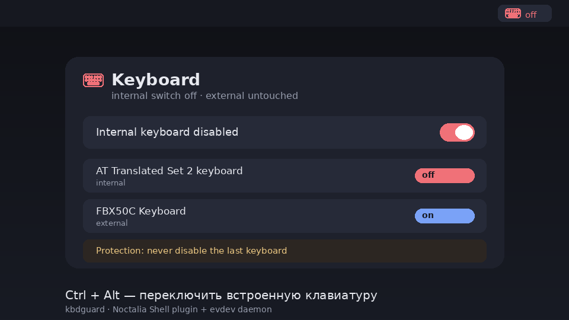

# Keyboard Guard

Bar widget + panel for [Noctalia Shell](https://github.com/noctalia-dev/noctalia-shell)
that switches the laptop's **internal keyboard** off and on.



## Features

- **Bar widget** with state colour: normal when the keyboard is on, red when off.
  Left click — toggle, right click — menu (toggle / panel / refresh / settings).
- **Panel** with the keyboard state, per-device switches (internal and external
  keyboards are listed separately), protection toggle and the active gesture.
- **Gesture** `Ctrl + Alt` on the internal keyboard — hold Ctrl, press Alt
  (any Alt, any timing; a third key cancels the gesture so `Ctrl+Alt+T` still works).
- **Protection**: refusing to disable a keyboard when it is the last one left.
- Works with any compositor (the switching happens in an evdev daemon, not in the
  compositor). Tested on [niri](https://github.com/niri-wm/niri).
- i18n: `en`, `ru`.

## Requirements

This plugin is the UI. Switching keys is done by the `kbdguard` daemon shipped in the
same repository — it must be installed and running:

```bash
cd kbdguard
make install-backend    # sudo: daemon + CLI + systemd unit (needs python-evdev)
```

Then add the widget: **Settings → Bar → Widgets → Keyboard Guard**.

If a `keyd` daemon grabs the same keyboard, the installer stops it — two daemons
cannot hold one device (`EVIOCGRAB` is exclusive).

## Settings

| Setting | Default | Description |
| --- | --- | --- |
| CLI path | `kbdguard` | command used to talk to the daemon |
| Poll interval | 2 s | how often the widget asks for the daemon state |
| Hide without daemon | off | hide the icon when the daemon is not running |

Gesture, device list and protection defaults live in `/etc/kbdguard/config.toml`.

## IPC

```bash
qs ipc call plugin:kbdguard toggle
qs ipc call plugin:kbdguard off
qs ipc call plugin:kbdguard on
qs ipc call plugin:kbdguard refreshStatus
```

## License

MIT
